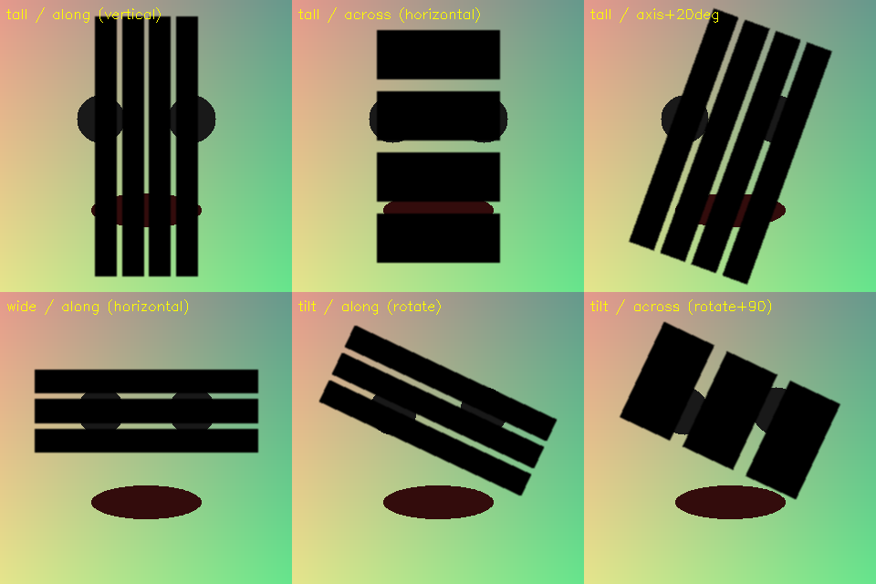

# ComfyUI-BarCensor

Censor a region with **parallel solid-color bars** (black / white / custom) instead of mosaic.

A companion to — and derivative of — [1038lab/ComfyUI-Mosaic](https://github.com/1038lab/ComfyUI-Mosaic):
that project does mosaic detection / creation, this one replaces the mosaic with proper censor bars.



> 中文说明：[使用说明.txt](使用说明.txt) ｜ [README_CN.md](README_CN.md)

## Why

- Mosaic looks like mosaic. A bar censor looks like a bar — straight edges, sharp corners.
- **All bars are parallel by construction.** Bar #1 defines the direction; every other bar is
  generated by translating bar #1 along its own normal. Measured angle spread across bars: `0.000 deg`.
- The angle can be read from the mask automatically (minimum area rectangle / PCA).
- Bar thickness auto-scales with the bar count, so the covered block keeps its size.

## Nodes

Menu: `🧪AILab` → `▬BarCensor`

### BarCensor — `Bar Censor (Parallel Bars)`

`image + optional mask → image + censor_mask + info`

| Parameter | Values | Meaning |
|---|---|---|
| `bar_count` | 1–32 | 1 = solid block; >1 = evenly spaced parallel bars |
| `angle_mode` | `auto_rect` (default), `auto_pca`, `horizontal`, `vertical`, `diagonal_down`, `diagonal_up`, `manual` | source of the base angle. `auto_rect` fits a minimum area rectangle to the mask and uses its long side |
| `angle` | -180–180 | only used by `manual` (0 = horizontal, 90 = vertical) |
| `bar_orientation` | `along_axis` (default), `across_axis`, `axis_plus_offset` | bars along / across / offset from the region axis |
| `axis_offset` | -180–180 | offset used by `axis_plus_offset` |
| `bar_shape` | `rectangle` (default), `conform_mask` | straight-edged rotated rectangle, or follow the mask outline |
| `thickness_mode` | `auto` (default), `manual` | `auto`: thickness = period × ratio, rescales with `bar_count` |
| `thickness_ratio` | 0.05–1.0 | thickness / period (`auto`), or its upper bound (`manual`) |
| `bar_thickness` | px | fixed thickness for `manual` |
| `length_mode` | `fit_region` (default), `full_image` | bar length = region span, or span the whole image |
| `length_overflow` | px | extra length at both ends |
| `color` | `black`, `white`, `gray`, `custom` | bar color |
| `custom_color` | hex, e.g. `#1a1a1a` | used when `color = custom` |
| `opacity` | 0–1 | bar opacity |
| `feather` | px | edge softening (0 = hard, 1 ≈ anti-aliased) |
| `mask` (optional) | MASK | region to censor; without it the whole image is striped |
| `invert_mask` | bool | invert the mask |
| `region_expand` | px | grow the block (`rectangle`) or dilate the mask (`conform_mask`) |

### MaskMerge — `Mask Merge (Combine Overlaps)`

`mask_a + up to 7 more → mask + info`

Merge several detector masks into one before censoring, so you only need a single
censor pass and never stack a second layer on already covered pixels.

| Parameter | Values | Meaning |
|---|---|---|
| `operation` | `union` (default), `intersection`, `add`, `average` | max / min / clamped sum / mean |
| `batch_mode` | `flatten` (default), `elementwise` | `flatten`: every frame of every input collapses into one mask. `elementwise`: frame i merges with frame i (video) |
| `threshold` | 0–1 | 0 = off; e.g. 0.5 binarizes soft masks |
| `mask_b` … `mask_h` | MASK | up to 8 slots total; cascade nodes for more |

## Typical wiring

```
detector A ─┐
detector B ─┼─> MaskMerge ──> one merged mask ──> BarCensor ──> censored image
detector C ─┘                                        ↑
image ───────────────────────────────────────────────┘
```

## Installation

```bash
cd ComfyUI/custom_nodes
git clone https://github.com/InfinityTechnology/ComfyUI-BarCensor.git
```

Restart ComfyUI. Dependencies (torch, numpy, opencv-python) ship with ComfyUI.

## Relation to ComfyUI-Mosaic

This project is **not** a fork of [1038lab/ComfyUI-Mosaic](https://github.com/1038lab/ComfyUI-Mosaic) —
no code was copied from it. It follows the same node interface convention
(`image + optional mask → image + mask`) so the two can be swapped inside a workflow,
and it exists because that project covers mosaic while this one covers bar censor.

Upstream: <https://github.com/1038lab/ComfyUI-Mosaic>

## Tips

- For video, avoid the auto angle modes: per-frame estimation jitters. Use `manual` or `horizontal`.
- Tall regions (a standing person) give vertical bars with `along_axis`;
  switch to `across_axis` if you want horizontal bars.
- `BarCensor` treats the whole mask as one region. If the merged mask holds several
  separate blobs, it builds one bounding block that covers all of them (gaps included).

## License

GPL-3.0 — same as the upstream project, so the two stay compatible.
